<div align="center">

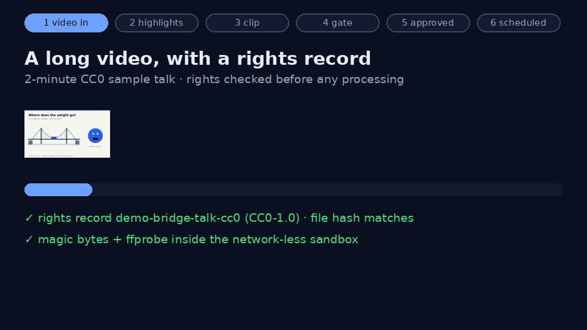

# fair-clip

**Turn rights-cleared long videos into short clips that add something real. Every clip passes a compliance gate and a human before YouTube sees it.**

[](https://github.com/Normansrule/fair-clip/actions/workflows/ci.yml)
[](https://github.com/Normansrule/fair-clip/actions/workflows/codeql.yml)
[](https://securityscorecards.dev/viewer/?uri=github.com/Normansrule/fair-clip)
[](LICENSE)
[](https://normansrule.github.io/fair-clip/)

*Automate the labor, never the judgment.*

</div>

> **Status: v0.3.0 (milestone 3).** Everything in the MVP (rights intake, captions, the full compliance gate, the approval dashboard, the audit log, dry-run and private uploads), five animated value-add templates, a read-only YouTube Analytics pull, a one-command desktop install, and now the **affiliate module**: a registry of the programs you joined, the products you actually tested and their exact links, an editor on every clip, and **spoken-disclosure detection timed against the transcript**. The markets *gate rules* are live; its editing UI is milestone 4. See [Roadmap](#roadmap).
>
> **Two ways in:** the [web demo](https://normansrule.github.io/fair-clip/) runs in your browser with sample footage, nothing to install · the [app](#install-the-app-ubuntu--wsl2) runs the real pipeline on your own computer.

## Contents

1. [What you'll see](#what-youll-see)
2. [Quick start (≈ 5 minutes)](#quick-start--5-minutes) · [Install the app](#install-the-app-ubuntu--wsl2)
3. [How it works](#how-it-works) · [Affiliate links](#affiliate-links-honestly)
4. [Walkthrough: your own video](#walkthrough-your-own-video)
5. [Project layout](#project-layout)
6. [Security](#security)
7. [Troubleshooting](#troubleshooting)
8. [References and further learning](#references-and-further-learning)
9. [Roadmap](#roadmap) · [Contributing, license, credits](#contributing-license-credits)

## What you'll see

| The review screen | The pipeline at a glance |
|---|---|
| 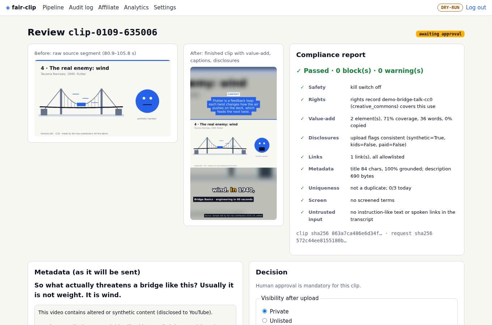 | 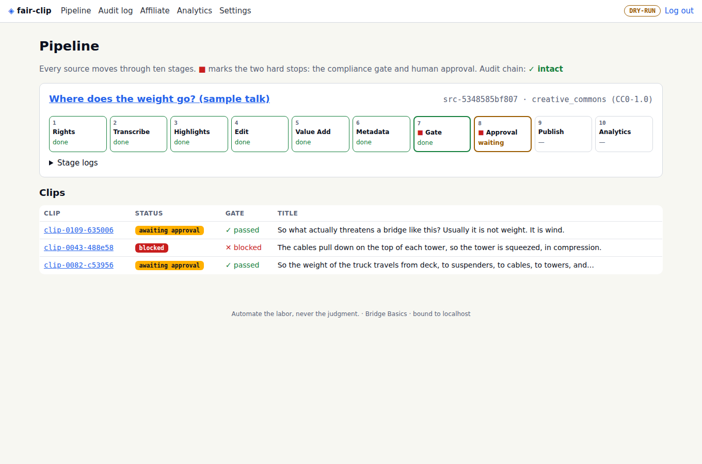 |
| *A person compares before/after, reads every gate result, then approves or rejects with a reason.* | *Ten stages per source. ■ marks the two hard stops. Clip B is blocked: it has no original value-add.* |

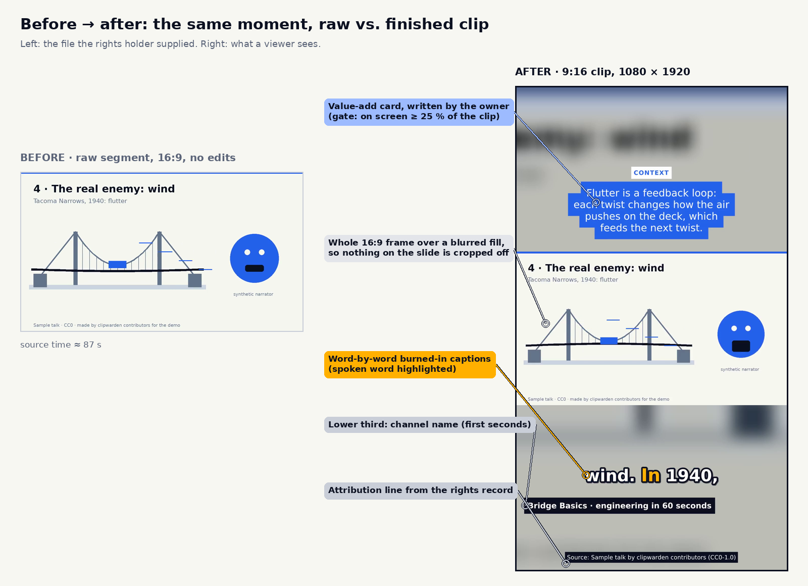

*Figure 1. The value-add rule in one picture: the clip carries original context, not just the source.*

## Quick start (≈ 5 minutes)

On Ubuntu (including WSL2). You need Git, Make, Python 3.11 or newer, and FFmpeg:

```bash
sudo apt update && sudo apt install -y git make python3-venv ffmpeg
git clone https://github.com/Normansrule/fair-clip.git && cd fair-clip
make setup        # creates .venv and installs hash-pinned dependencies
make demo         # runs the whole pipeline on the bundled CC0 sample, no network, no Google account
```

Expected output (scores can differ slightly between FFmpeg versions):

```text
[1-3] ingested src-5348585bf807: 5 ranked candidates (backend: local-trusted)
      #1  80.9-105.8s S=+1.140 So what actually threatens a bridge like this? Usually it is…
      ...
[4-7] clip A clip-0109-635006: PASSED -> awaiting approval
[4-7] clip B clip-0043-488e58: BLOCKED: VALUE_ADD_MISSING
[4-7] clip C clip-0082-c53956: PASSED -> awaiting approval
[audit] 8 entries, chain intact
done in 45s. Review and approve at the dashboard:
```

Then review the clips like a real owner would:

```bash
make dashboard    # prints a one-time password, serves http://127.0.0.1:8765
```

Open **http://127.0.0.1:8765**, log in, open clip A, and approve it with a reason. Then run `.venv/bin/python -m fairclip.cli --config demo-data/fairclip.toml publish`. Nothing leaves your machine: the demo is **dry-run**, and the exact request that *would* be sent lands in `demo-data/dry-run/<clip>.json`.

<details><summary>Why does the demo say <code>backend: local-trusted</code>?</summary>

Untrusted media must run in the network-less Docker sandbox. The demo's sample is *our own* file, pinned by SHA-256 in `examples/demo/SHA256SUMS`, so it may run on your machine without Docker. Any other file is refused until you `make sandbox` (see [Security](#security)).
</details>

## Install the app (Ubuntu / WSL2)

For day-to-day use, install fair-clip as an app instead of running it from a clone. The installer downloads the latest release, **checks its SHA-256** (and its signed build provenance if you have `gh` logged in), installs hash-pinned dependencies into a private environment, and adds a `fair-clip` command plus a launcher in your apps menu. On WSL2 with WSLg, that launcher appears in the Windows Start menu. No `sudo`, no build step.

```bash
sudo apt update && sudo apt install -y python3-venv ffmpeg curl
curl -fsSL https://raw.githubusercontent.com/Normansrule/fair-clip/main/scripts/install.sh | bash
fair-clip app        # starts the dashboard and opens it in your browser
```

The first launch opens a **one-time welcome link** where you choose your password (the link lives only in memory and dies after one use). Your config and data live in `~/.local/share/fair-clip/`. In Chrome or Edge, choose **Install fair-clip** (or *Install page as app*) to give the dashboard its own window. Update by running the installer again; remove with `bash ~/.local/share/fair-clip/app/install.sh --uninstall` (your data is kept).

Always-on instead? `make compose-init && make compose-up` runs the same app in Docker with a separate network-less media container (see [Walkthrough](#walkthrough-your-own-video)).

## How it works

<picture>
  <source media="(prefers-color-scheme: dark)" srcset="assets/pipeline-dark.svg">
  
</picture>

*Figure 2. One clip's journey. It can't pass stage 7 with any block, or stage 8 without a person.*

### 1 · Rights intake (hard stop)
Every source needs a **rights record**: your own content, written permission, a license, or public domain / Creative Commons with attribution. No record means the file is never stored, probed or transcribed (`ingest_refused` in the audit log). If the record names a file hash, the file must match it. Non-commercial licenses on a monetized channel, and "no derivatives" licenses, are refused, because a clip is a derivative. → [`rights.py`](src/fairclip/rights.py)

### 2 · Transcription
Word-level timestamps come from either a transcript the rights holder supplies, or local **faster-whisper**. The audio is decoded *inside the sandbox* first, so the model only ever sees a NumPy array. → [`transcribe.py`](src/fairclip/transcribe.py)

### 3 · Highlight detection
Every run of whole sentences lasting 20–60 s is scored, and overlapping windows are thinned out (non-maximum suppression):

```math
S = w_E\,z(E) + w_R\,R + w_r\,z(r) + w_D\,D - w_Q\,Q
```

The terms are energy (dBFS), relevance to your channel's topics (0–1), speech rate (words/s), scene-cut density (0–1) and silence ratio (0–1). Intuition, units, worked examples and limits: [EQUATIONS.md §1](docs/EQUATIONS.md#1-highlight-score).

<picture>
  <source media="(prefers-color-scheme: dark)" srcset="assets/eq1-contributions-dark.svg">
  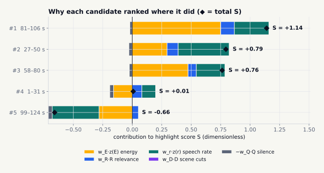
</picture>

*Figure 3. Why each real candidate ranked where it did.*

### 4 · Editing
A 9:16 reframe: either the whole frame over a blurred fill (slides) or a smart crop that follows on-screen motion (a talking head). Pauses longer than 0.6 s are cut, but only between words and only when the audio is truly quiet. A **2-second hook** shows a *verbatim* quote, never an invented one. Word-by-word burned-in captions, a lower third and the attribution line are drawn in one pass from an escaped ASS subtitle file. → [`media/`](src/fairclip/media)

### 5 · Value-add layer (required)
YouTube treats permission and originality as separate things: reused content needs significant original commentary or modification, *even with the creator's permission* ([yt-monetization](docs/REFERENCES.md#yt-monetization)). So owner-written cards (context, commentary, analysis, explainer) must be on screen for **≥ 25 %** of the clip, with at least 8 words, and less than 60 % of their phrases copied from the transcript. AI drafts don't count until you approve them. [EQUATIONS.md §5](docs/EQUATIONS.md#5-value-add-coverage-and-originality)

Besides the plain card there are five **animated templates**: a key number that counts up, a definition, steps that appear one by one, an A-vs-B comparison and growing bars. Each still carries your own sentence, and every word and number on it goes through the gate. On 9:16 they sit above the source frame, so nothing original is covered. How to use them: [docs/TEMPLATES.md](docs/TEMPLATES.md).

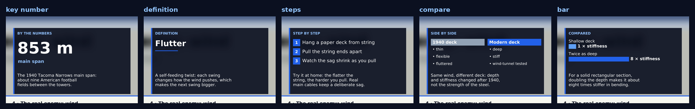

*Figure 3b. The five templates, each drawn by the same escaped ASS renderer as the captions.*

### 6 · Metadata
The title is the clip's most on-topic sentence. Tags come from its words. The description *frame* (disclosures first, then summary, credit, links, sources) is assembled by code. An optional model, preferably local, may propose the title and summary, but its output is parsed as untrusted data. → [`metadata.py`](src/fairclip/metadata.py), [`llm.py`](src/fairclip/llm.py)

### 7 · Compliance gate (hard stop)
60 checks in 11 groups, all run every time and all reported. **47 block** the clip; **13 warn**, and the reviewer must acknowledge each warning. The diagram below is generated from [`gate/reasons.py`](src/fairclip/gate/reasons.py), so it can't drift from the code, and a test proves every reason can actually be triggered.

<!-- gate-mermaid:start -->
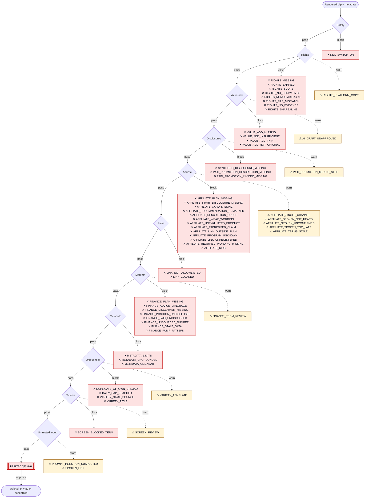
<!-- gate-mermaid:end -->

<picture>
  <source media="(prefers-color-scheme: dark)" srcset="assets/gate-flow-dark.svg">
  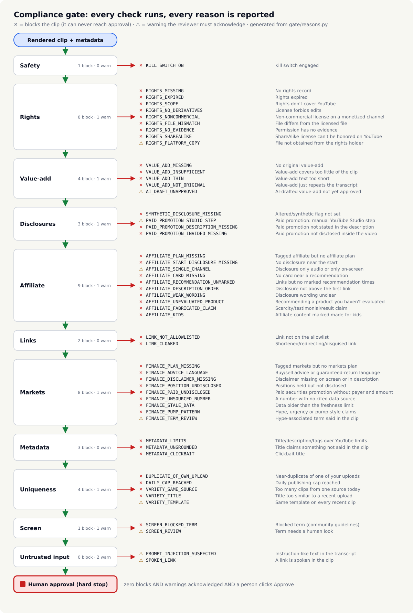
</picture>

*Figure 4. Every block (✕) and warning (⚠) reason, with plain-language names. Rules and sources: [POLICY.md](docs/POLICY.md).*

### 8 · Human approval (hard stop)
The review page shows before/after video, the full report and the exact request body. Approving binds the **SHA-256 of the clip file and of the request body**; the publisher re-checks both and refuses if anything changed. Rejecting needs a reason. Markets, affiliate and sponsored clips can never skip this step.

### 9 · Schedule + publish
Uploads go through YouTube Data API v3 using **one scope, `youtube.upload`**. Privacy and the scheduled `publishAt` time are set in the same insert call, so the broad "manage your account" scope is never needed ([POLICY.md](docs/POLICY.md)). Dry-run is the default. Going live takes a config change, a typed confirmation, at least one completed dry run and an intact audit chain.

### 10 · Analytics
`fair-clip analytics connect` asks Google for **one read-only scope** (`yt-analytics.readonly`), stored as a *separate* token from the upload one. Then **Pull now** on the Analytics page (or `fair-clip analytics pull`) fetches views, watch time, average view duration and percentage, and the retention curve for every published clip. Impressions and click-through rate aren't in that API, so import them from a Studio export with `fair-clip analytics import`. The dashboard shows r(τ) and the area under it (≈ average % viewed), and, once **10 clips with ≥ 50 real views** each exist, can *propose* new highlight weights from them (**Propose from live analytics**). Nothing changes until you approve; each approved update moves any single weight by at most 0.05. [EQUATIONS.md §3–4](docs/EQUATIONS.md#3-retention-curve)

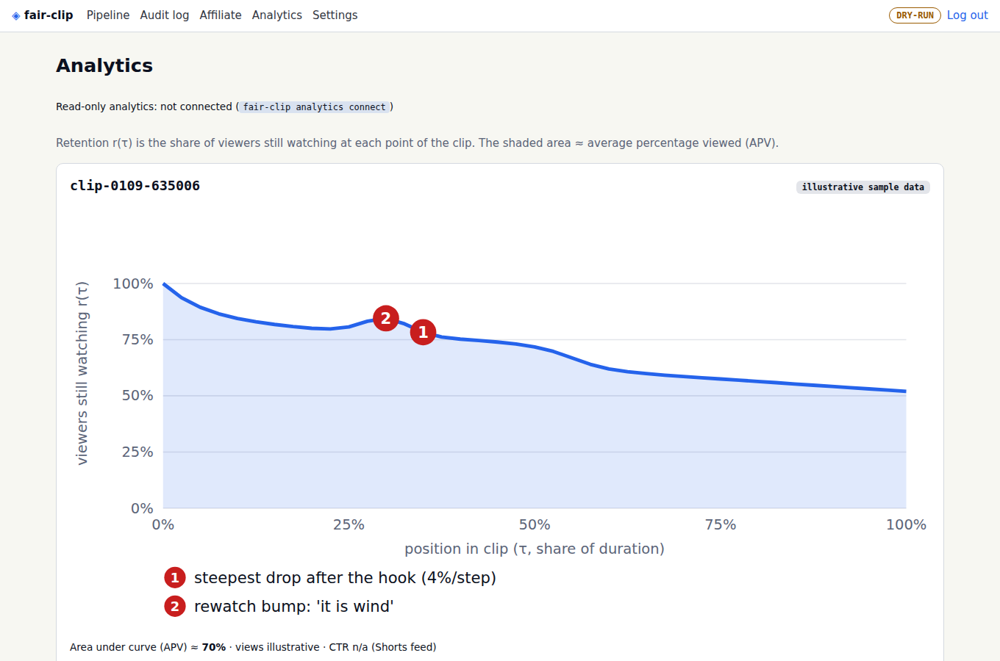

*Figure 5. Annotated retention chart (illustrative sample data, labelled as such in the app).*

### Affiliate links, honestly

The **Affiliate** page holds what's true: the programs you joined (with their terms and when you last re-read them), the products you actually evaluated (in your own words), and the exact links you were given. A clip can only carry registered links, and the gate checks four things:
- the program is active;
- the link is the one you registered for that product;
- the program's required wording is in your disclosure;
- the disclosure is shown or *said* in the first 10 seconds.

"Said" is checked against the clip's timed transcript and counts only once you confirm it's your disclosure. Denials like "not sponsored by" never count. Guide: [docs/AFFILIATE.md](docs/AFFILIATE.md).

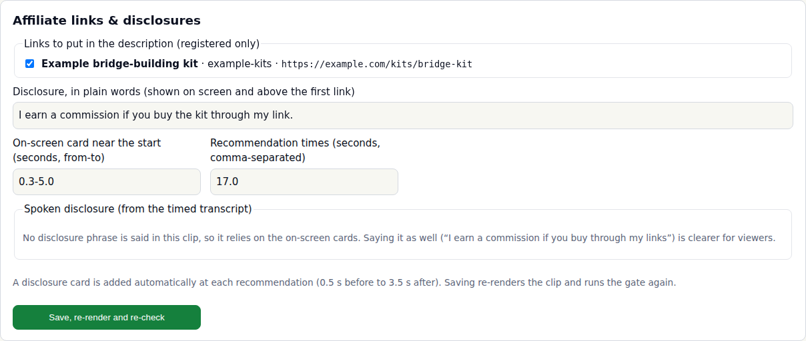

*Figure 6a. Adding a registered link to a clip. Saving re-renders the clip with disclosure cards and re-runs the gate.*

### Disclosures, done properly

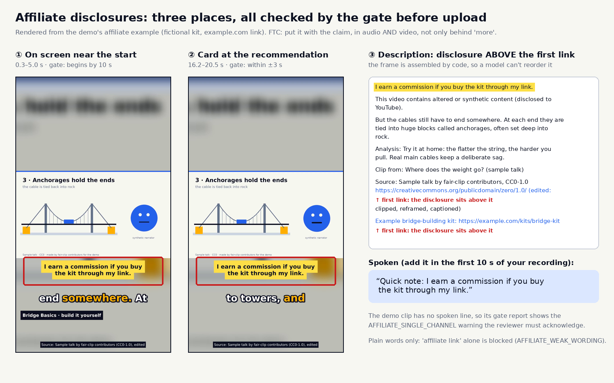

*Figure 6. The gate checks all three placements. The demo clip has no spoken line, so it carries an `AFFILIATE_SINGLE_CHANNEL` warning. FTC guidance prefers audio and video together ([ftc-disclosures-101](docs/REFERENCES.md#ftc-disclosures-101)).*

## Walkthrough: your own video

1. **Configure.** `cp fairclip.example.toml fairclip.toml`, then set `channel.name` and `channel.topics`. ✔ `fair-clip --help` runs.
2. **Build the sandbox.** `make sandbox && make sandbox-test`. ✔ Six green checks: no network, read-only, non-root, and more.
3. **Write a rights record** (`rights.json`). The `source_sha256` line is optional but recommended: get the value with `sha256sum talk.mp4`.
   ```json
   {"record_id": "my-talk-2026-09", "basis": "own_content", "source_title": "My talk",
    "rights_holder": "Me", "evidence": "recorded by me on 2026-09-12",
    "source_sha256": "<output of: sha256sum talk.mp4>"}
   ```
4. **Ingest.** `fair-clip ingest talk.mp4 --rights rights.json` (add `--transcript t.json` if you have one; otherwise `pip install '.[asr]'` for faster-whisper). ✔ It prints ranked candidates with their scores.
5. **Plan a clip.** Copy [`examples/demo/plan.json`](examples/demo/plan.json), write *your own* context or commentary, then run `fair-clip plan <candidate-id> --plan-file plan.json`. ✔ It prints `planned clip-…`.
6. **Render and gate.** `fair-clip render <clip-id>`. ✔ You see a pass/warn/block line for every check; exit code 2 means blocked.
7. **Review.** `fair-clip dashboard`, open the clip, and approve or reject. ✔ The audit log shows your decision with the clip and request hashes.
8. **Publish (dry run).** `fair-clip publish`. ✔ `data/dry-run/<clip>.json` holds the exact request.
9. **Go live, later.** Follow [SETUP_YOUTUBE.md](docs/SETUP_YOUTUBE.md): separate Cloud project, 2-Step Verification, Desktop OAuth client, `fair-clip auth login`, `publish enable-live`.

Prefer containers? `make compose-init && make compose-up` runs the dashboard in one container and FFmpeg in a second, network-less one. They share only `data/jobs`, and the app never gets the Docker socket.

## Project layout

```text
fair-clip/
├── src/fairclip/
│   ├── models.py          # strict schemas for every stage (unknown fields = reject)
│   ├── rights.py          # stage 1: rights records (hard stop)
│   ├── transcribe.py      # stage 2: sidecar or faster-whisper (fed PCM from the sandbox)
│   ├── scoring.py         # stage 3: Eq. 1 highlight score, Eq. 4 bounded weight updates
│   ├── media/
│   │   ├── sandbox.py     # docker / worker / pinned-trusted runners for FFmpeg
│   │   ├── worker.py      # stdlib-only job runner inside the network-less media container
│   │   ├── probe.py       # magic bytes + ffprobe allowlists
│   │   ├── analyze.py     # audio energy, scene cuts, motion centroid, frame hashes
│   │   ├── timeline.py    # jump cuts and the source→clip time map
│   │   ├── overlay.py     # captions, hook, cards, disclosures (escaped ASS)
│   │   ├── templates.py   # animated value-add templates (key number, steps, compare, bar...)
│   │   └── edit.py        # stage 4: the FFmpeg filter graph
│   ├── metadata.py        # stage 6: grounded title/description/chapters
│   ├── llm.py             # untrusted-text handling, optional local model adapter
│   ├── gate/              # stage 7: reasons registry + checks
│   ├── approval.py        # stage 8: decisions bound to hashes
│   ├── publish/           # stage 9: request body, OAuth, uploader, publisher
│   ├── analytics.py       # stage 10: Eq. 2–3 metrics
│   ├── analytics_api.py   # read-only YouTube Analytics pull + live weight-proposal input
│   ├── affiliate.py       # affiliate registry (programs, evaluated products, links) + spoken-disclosure detection
│   ├── data/              # bundled fonts and the default screen-terms list
│   ├── audit.py           # append-only hash-chained log
│   ├── vault.py · redact.py
│   └── web/               # dashboard (FastAPI + Jinja2, no inline JS) + app manifest/icons
├── tests/                 # 280+ tests: every gate reason, security, equations, templates, affiliate, end-to-end
├── scripts/               # install.sh (the app), demo, asset/template renderers, sandbox smoke test
├── examples/demo/         # CC0 sample talk, transcript, rights record, plan
├── assets/                # generated visuals (sources: scripts/ + assets/src/)
├── docs/                  # POLICY, SECURITY_MODEL, EQUATIONS, TEMPLATES, AFFILIATE, STYLE, SETUP_YOUTUBE, REFERENCES
├── site/                  # GitHub Pages: overview + interactive demo
├── sandbox/Dockerfile.media · Dockerfile · docker-compose.yml
└── .github/               # CI, CodeQL, Scorecard, Pages, links, release, Dependabot
```

## Security

<picture>
  <source media="(prefers-color-scheme: dark)" srcset="assets/security-dark.svg">
  
</picture>

*Figure 7. What runs sandboxed, where the token lives, and what reaches Google.*

- **Secrets:** the refresh token is kept in the OS keychain or an AES-GCM vault, never logged (a redaction filter catches it) and never committed (gitleaks). It can be revoked from the dashboard. There is no API key anywhere: uploads require OAuth.
- **What leaves your machine:** only the approved clip and its exact metadata, sent to Google's upload API; and the refresh token, sent to Google's token endpoint. The optional model adapter refuses non-HTTPS remote endpoints and prefers a local one. No telemetry.
- **Untrusted input:** media is decoded only in the sandbox. Transcripts and model output are treated as data and checked against schemas, allowlists and grounding rules.
- **Supply chain:** hash-pinned Python lockfiles, digest-pinned images, SHA-pinned Actions, least-privilege workflow tokens, CodeQL, Dependabot, Scorecard, and releases with checksums and provenance.
- Full threat model, covering stolen tokens, malicious media, prompt injection, supply chain, insider misuse and policy strikes: [docs/SECURITY_MODEL.md](docs/SECURITY_MODEL.md). To report a vulnerability: [SECURITY.md](SECURITY.md).

## Troubleshooting

| You see | Why | Fix |
|---|---|---|
| `refused: refusing to process untrusted media on the host without the Docker sandbox` | Only the pinned demo file may skip the sandbox | `make sandbox` (Docker must be running), then retry |
| `ffmpeg: not found` or `FileNotFoundError: 'ffprobe'` | FFmpeg isn't installed | `sudo apt install -y ffmpeg` |
| `bad host` (HTTP 400) in the browser | You opened the dashboard by LAN IP or hostname; it only answers on loopback | Use `http://127.0.0.1:8765` |
| `invalid_grant` when publishing, about a week after `auth login` | Your OAuth app is in Testing mode, so refresh tokens expire after 7 days | `fair-clip auth login` again, or move the app to production ([SETUP_YOUTUBE.md](docs/SETUP_YOUTUBE.md)) |
| Scheduled uploads stay private forever | Unaudited API projects (created after 28 July 2020) can only upload private | Approve as Private and publish in Studio, or complete Google's API audit |
| `fair-clip: command not found` right after installing | `~/.local/bin` isn't on your `PATH` yet | `echo 'export PATH="$HOME/.local/bin:$PATH"' >> ~/.bashrc && source ~/.bashrc` |
| `fair-clip app` opens nothing on WSL2 | No Windows browser bridge found | Open the printed `http://127.0.0.1:8765/…` link yourself (Windows forwards localhost to WSL2) |
| Analytics: `refused the request (403)` | The analytics token was revoked or never granted | `fair-clip analytics connect` again |
| `ERROR: THESE PACKAGES DO NOT MATCH THE HASHES` | An interrupted download, or an unsupported Python version | `rm -rf .venv && make setup` with Python 3.11–3.13 |

## References and further learning

All sources are primary and verified: [docs/REFERENCES.md](docs/REFERENCES.md). Good English-language next reads:

- YouTube Data API v3, *Videos: insert*: <https://developers.google.com/youtube/v3/docs/videos/insert>
- YouTube channel monetization policies (reused and inauthentic content): <https://support.google.com/youtube/answer/1311392>
- FTC, *Disclosures 101 for Social Media Influencers*: <https://www.ftc.gov/business-guidance/resources/disclosures-101-social-media-influencers>
- OWASP, *Top 10 for LLM Applications 2025*: <https://genai.owasp.org/llm-top-10/>
- Google, *OAuth 2.0 for iOS & Desktop Apps* (PKCE, loopback): <https://developers.google.com/identity/protocols/oauth2/native-app>
- FFmpeg filters documentation: <https://ffmpeg.org/ffmpeg-filters.html>

**Built with / looked at** (licenses honored; nothing copied):

| Project | Role here |
|---|---|
| [FFmpeg](https://github.com/FFmpeg/FFmpeg) | all media processing, sandboxed |
| [SYSTRAN/faster-whisper](https://github.com/SYSTRAN/faster-whisper) | optional local transcription (`.[asr]`) |
| [m-bain/whisperX](https://github.com/m-bain/whisperX) | reference for word alignment; not a dependency |
| [Breakthrough/PySceneDetect](https://github.com/Breakthrough/PySceneDetect) | same idea as our FFmpeg `scene` score; not a dependency |
| [youtube/api-samples](https://github.com/youtube/api-samples) | resumable-upload retry pattern |
| [remotion-dev/remotion](https://github.com/remotion-dev/remotion), [motion-canvas](https://github.com/motion-canvas/motion-canvas) | looked at for animated templates; milestone 2 draws them with libass inside FFmpeg instead (no Node runtime, same sandbox). Remotion's license needs checking before company use |
| [gitleaks](https://github.com/gitleaks/gitleaks), [OpenSSF Scorecard](https://github.com/ossf/scorecard) | CI security |

## Roadmap

1. ✅ **MVP:** own and licensed content, dry-run and private uploads, rights intake, captions, compliance gate, approval UI, audit log.
2. ✅ **Value-add templates** (five animated explainers), **YouTube Analytics pull** (read-only scope, separate token), **weight proposals from live data**, one-command app install.
3. ✅ **Affiliate module:** a registry of programs (terms, review dates, link prefixes, required wording), evaluated products and exact links; a per-clip editor that re-renders; spoken-disclosure detection timed against the transcript.
4. Markets module UI: data-source connectors with timestamps, mandatory review flow.
5. Hardening: ✅ first independent review fixed (link obfuscation, hidden characters, in-video paid disclosure, upload race, audit-chain concurrency; see [CHANGELOG](CHANGELOG.md)); next, fuzzing of media inputs and prompt injection.

## Contributing, license, credits

Contributions are welcome: see [CONTRIBUTING.md](CONTRIBUTING.md) (every new gate rule needs a test that triggers it). Licensed under [Apache-2.0](LICENSE). Third-party material and the CC0 sample: [CREDITS.md](CREDITS.md). Not legal advice: you are responsible for what you publish.
