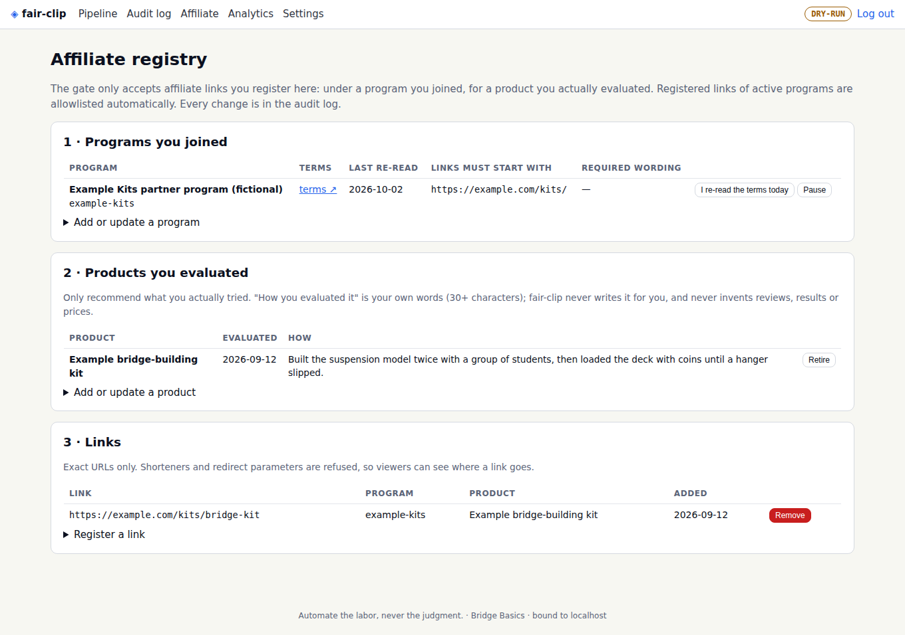

# The affiliate module

fair-clip lets you earn from affiliate links **without misleading anyone**. You keep a small registry of what's true: the programs you joined, the products you tested, the exact links you were given. The compliance gate then refuses anything that doesn't match it. The rules and their sources are in [POLICY.md](POLICY.md#affiliate-marketing-registry-and-editor-affiliatemd).



## 1 · Set up the registry (once)

Open **Affiliate** in the dashboard (or use the command line, below).

1. **Programs you joined.** Give each one an ID, its name, the URL of its terms, and the link prefixes its links start with (each prefix must include the `/` after the host, so `https://shop.example/` matches but `https://shop.example.evil.net/` doesn't). If the program requires specific wording in your disclosure, paste it from the program's current terms into *Required wording*.
2. **Products you evaluated.** The name, the date, and in your own words how you evaluated it (at least 30 characters). fair-clip never writes this for you, and it has no feature that invents reviews, results, prices or scarcity.
3. **Links.** The exact URL, the program and the product. Shorteners (`bit.ly`, `linktr.ee`, …) and redirect parameters (`?url=`, `?next=`, …) are refused, so viewers can see where a link goes.

Every change is validated as a whole (a link must point at a real program and an evaluated product) and written to the audit log.

**Keep it honest over time:**
- **I re-read the terms today**: press it after you actually re-read a program's terms. After 180 days without it, clips using that program carry a warning.
- **Pause** a program you left. Its links stop working in the gate immediately.
- **Retire** a product you no longer stand behind. It can't be linked any more.

## 2 · Add links to a clip

On a clip's review page, **Affiliate links & disclosures**:


- Tick the registered links to include. Paused programs and retired products are greyed out.
- Write the disclosure in plain words, e.g. *"I earn a commission if you buy through my links."* If a program requires wording, the editor shows it.
- **Start card**: when the on-screen disclosure shows near the start (e.g. `0.3-5`).
- **Recommendation times**: when you recommend each product (e.g. `17, 32.5`). A disclosure card is drawn automatically from 0.5 s before to 3.5 s after each one.
- **Spoken disclosure**: fair-clip searches the clip's **timed transcript** for disclosure phrases and lists where each is said.
  - **Nothing counts until you tick it.** Even in your own video, a guest or co-host may be the one talking, or the words may be about something else.
  - Tick a line only if it's *your* disclosure for these links.
  - It must be said in the first 10 seconds, within 1.5 s of the time you tick.

**Save, re-render and re-check** rebuilds the clip and runs the gate again. Approved or published clips are frozen.

## 3 · What the gate checks

| Check | Result |
|---|---|
| Link is for a program you registered and haven't paused | `AFFILIATE_PROGRAM_UNKNOWN` (block) |
| Link is the exact URL registered for that program and product | `AFFILIATE_LINK_UNREGISTERED` (block) |
| Product is in your registry and not retired | `AFFILIATE_UNEVALUATED_PRODUCT` (block) |
| The program's required wording is in your disclosure | `AFFILIATE_REQUIRED_WORDING_MISSING` (block) |
| Terms re-read in the last 180 days | `AFFILIATE_TERMS_STALE` (warn) |
| Disclosure said or shown in the first 10 s | `AFFILIATE_START_DISCLOSURE_MISSING` (block) |
| Both said **and** shown | `AFFILIATE_SINGLE_CHANNEL` (warn) |
| The spoken disclosure is in the transcript where the plan says | `AFFILIATE_SPOKEN_NOT_HEARD` (warn) |
| A disclosure is said but you haven't confirmed it | `AFFILIATE_SPOKEN_UNCONFIRMED` (warn) |
| A registered or program-prefixed link appears anywhere (title, description, card) without being in the clip's affiliate plan | `AFFILIATE_LINK_OUTSIDE_PLAN` (block) |
| A spoken disclosure only after 10 s, and no start card | `AFFILIATE_SPOKEN_TOO_LATE` (warn) |
| Card at every recommendation; disclosure above the first link; plain wording; no fake urgency or reviews; not made for kids | as before ([POLICY.md](POLICY.md)) |

A registered link is allowlisted only for a clip whose affiliate plan lists it, so it always comes with its disclosures. Any other link in a title, description or card is still blocked (`LINK_NOT_ALLOWLISTED`).

**The registry is checked again later.** If you pause a program, retire a product or remove a link, clips that use it can no longer be approved or uploaded, even ones that passed the gate before. Re-render them.

## Command line

```bash
fair-clip affiliate show                       # programs (with terms age), products, links
fair-clip affiliate import registry.json       # replace the registry from a file (validated as a whole)
fair-clip affiliate review-terms PROGRAM_ID    # "I re-read the terms today"
fair-clip affiliate heard CLIP_ID              # where disclosure phrases are said in a clip
```

The file format is the demo's [`examples/demo/affiliate.json`](../examples/demo/affiliate.json): `programs`, `products` and `links`, with the same fields as the dashboard forms.

## How spoken-disclosure detection works

The clip's words come from the transcript with word-level times, mapped onto the clip's own timeline (after jump cuts). fair-clip searches the joined words for plain disclosure phrases:
- "I / we earn / get / make / receive a commission" (or money, or paid)
- "I'm / we're paid", "I'm / we're compensated"
- "paid link / promotion / partnership"
- "sponsored by"
- "affiliate commission"

Each match is timed by the word it starts in.

Lookalikes and denials don't count:
- "I paid nothing", "earnings", "I earn a living", "out of commission";
- a negation earlier in the same sentence: "this video is **not**, in any way, sponsored by them", "we **don't** earn a commission";
- a denial right after: "I'm paid **nothing**", "we're paid by **no one**".

Ordinary honest phrasing still counts: "I earn a commission, at no extra cost to you." Curly apostrophes (’) are treated like straight ones. The same rules check the sentence on your cards, and the web demo uses the identical rules (a test runs both on the same sentences).

**Not legal advice.** These checks follow the FTC's published guidance (see [POLICY.md](POLICY.md)) and make honest disclosure the default. You remain responsible for what you publish and for each program's terms.
