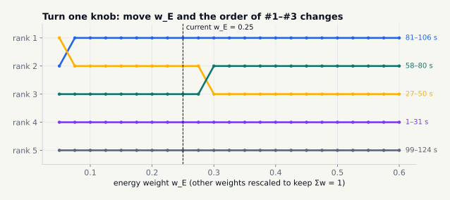
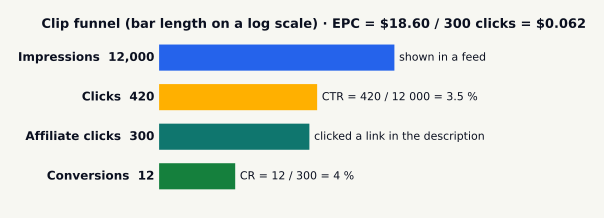
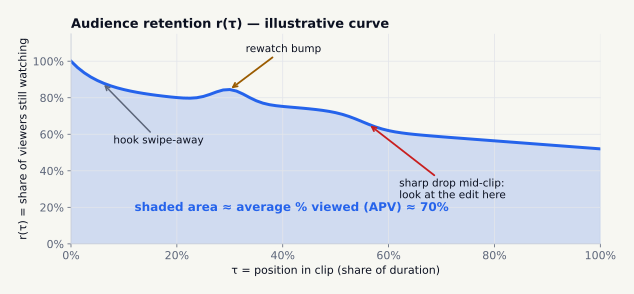
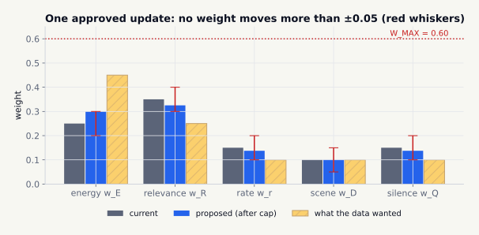
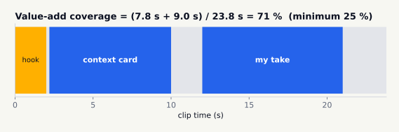

# The math, explained

Every equation follows the same pattern: **intuition → equation → symbols with units → worked example → picture → limits**. Every worked example is recomputed by [`tests/test_equations.py`](../tests/test_equations.py), so if this page and the code ever disagree, CI fails.

- [1. Highlight score](#1-highlight-score)
- [2. Clip metrics](#2-clip-metrics)
- [3. Retention curve](#3-retention-curve)
- [4. Bounded learning from analytics](#4-bounded-learning-from-analytics)
- [5. Value-add coverage and originality](#5-value-add-coverage-and-originality)
- [6. Near-duplicate detection](#6-near-duplicate-detection)

---

## 1. Highlight score

**Intuition.** A good short is usually a stretch where the speaker is energetic, on-topic and talking briskly, with something changing on screen and little dead air. We score every sentence-aligned window on those five signals and rank the windows.

```math
S \;=\; w_E\, z(E) \;+\; w_R\, R \;+\; w_r\, z(r) \;+\; w_D\, D \;-\; w_Q\, Q \tag{1}
```

where

| Symbol | Meaning | Unit / range |
|---|---|---|
| $E$ | audio energy: mean root-mean-square (RMS) level of the window, in decibels relative to full scale | dBFS (≤ 0) |
| $r$ | speech rate: words in the window ÷ window length | words/s |
| $R$ | transcript relevance: cosine similarity between the window's word counts and the channel's topic words (Eq. 1b) | 0 … 1 |
| $D$ | scene-change density: cuts per minute ÷ $D_{ref}$, capped at 1, with $D_{ref}$ = 6 cuts/min | 0 … 1 |
| $Q$ | silence ratio: share of 50 ms windows quieter than −40 dBFS | 0 … 1 |
| $z(x)$ | standard score across this video's candidates: $z(x)=\dfrac{x-\bar x}{\sigma_x}$, clipped to ±3 (Eq. 1a) | unitless |
| $w_\ast$ | weights, each in [0.02, 0.60], summing to 1 (Eq. 4) | unitless |
| $S$ | highlight score; only the ranking matters | unitless |

Energy and speech rate are z-scored because their raw units (dB, words/s) mean different things for every speaker and microphone. Ranking against the same video's other moments is what matters. $R$, $D$ and $Q$ are already in [0, 1].

**Sub-equations**

```math
z(x_i) = \operatorname{clip}\!\left(\frac{x_i-\bar x}{\sigma_x},\,-3,\,3\right) \tag{1a}
\qquad
R = \frac{\sum_{t\in T} c_t}{\lVert c\rVert_2\,\sqrt{|T|}} \tag{1b}
\qquad
E = \frac{1}{N}\sum_{k=1}^{N} 20\log_{10}\!\sqrt{\tfrac{1}{n}\textstyle\sum_j x_{kj}^2} \tag{1c}
```

$c_t$ is how often content word $t$ occurs in the window (stop-words removed), $T$ is the set of topic words, $x_{kj}$ are audio samples scaled to [−1, 1], and the RMS is taken in $N$ windows of $n$ = 800 samples (50 ms at 16 kHz).

**Worked example.** A window with $z(E)=+1.2$, $R=0.42$, $z(r)=+0.5$, $D=0.33$, $Q=0.10$ and the default weights (0.25, 0.35, 0.15, 0.10, 0.15):

```math
S = 0.25(1.2) + 0.35(0.42) + 0.15(0.5) + 0.10(0.33) - 0.15(0.10) = 0.300 + 0.147 + 0.075 + 0.033 - 0.015 = \mathbf{0.540}
```

Sub-examples:
- Energies of −20, −22, −18, −24 dBFS have mean −21 and σ = √5 ≈ 2.236, so the −18 dBFS window scores z = 3/√5 ≈ **1.342**.
- The words "bridge bridge wind deck flutter" against topics {bridge, wind, cable} give $R = 3/(\sqrt7\sqrt3) ≈$ **0.655**.
- Two cuts in 30 s is 4 cuts/min, so D = 4/6 ≈ **0.667**.
- A full-scale-0.5 sine wave measures **−9.03 dBFS** (its RMS is 0.5/√2).

<picture>
  <source media="(prefers-color-scheme: dark)" srcset="../assets/eq1-contributions-dark.svg">
  
</picture>

*Figure 1. Why each real candidate from the demo ranked where it did. Each bar segment is one term of Eq. 1; ◆ marks the total. In this synthetic talk the loud, fast "it is wind" segment wins.*

<picture>
  <source media="(prefers-color-scheme: dark)" srcset="../assets/eq1-sensitivity-dark.svg">
  
</picture>

*Figure 2. What changes when one variable changes: as w_E grows past ≈ 0.28, the louder anchorage segment overtakes the faster cables segment; below ≈ 0.07 the order of #1 and #2 flips. Try every weight live in the [interactive demo](https://normansrule.github.io/fair-clip/demo.html).*

**Limits.** z-scores need at least two candidates and are meaningless when every window is alike (then all z = 0). $R$ is a bag-of-words measure: it can't tell "the bridge didn't fail" from "the bridge failed". The score finds lively, on-topic moments, not *true* or *fair* ones. That is what the value-add rule and the human reviewer are for. Windows always start and end on sentence boundaries, so a clip never starts mid-thought.

---

## 2. Clip metrics

**Intuition.** Four questions: did people click, how long did they stay, and, for affiliate clips, did the clicks turn into sales, and what is each click worth?

```math
\mathrm{CTR}=\frac{\text{clicks}}{\text{impressions}}\qquad
\mathrm{AVD}=\frac{\text{total watch time}}{\text{views}}\qquad
\mathrm{APV}=\frac{\mathrm{AVD}}{\text{clip duration}}\qquad
\mathrm{CR}=\frac{\text{conversions}}{\text{affiliate clicks}}\qquad
\mathrm{EPC}=\frac{\text{affiliate earnings}}{\text{affiliate clicks}} \tag{2}
```

| Symbol | Meaning | Unit |
|---|---|---|
| CTR | click-through rate | fraction |
| AVD | average view duration (YouTube's `averageViewDuration`, [yt-analytics-metrics](REFERENCES.md#yt-analytics-metrics)) | s |
| APV | average percentage viewed (`averageViewPercentage`) | fraction |
| CR | conversion rate | fraction |
| EPC | earnings per click | currency/click |

**Worked example.** 420 clicks from 12,000 impressions → CTR = **3.5 %**. 41,250 s watched over 1,500 views → AVD = **27.5 s**, and on a 45 s clip APV = **61.1 %**. 12 sales from 300 affiliate clicks → CR = **4 %**. $18.60 earned → EPC = **$0.062**. Every function returns 0 instead of dividing by zero.

<picture>
  <source media="(prefers-color-scheme: dark)" srcset="../assets/eq2-funnel-dark.svg">
  
</picture>

*Figure 3. The worked example as a funnel. Bar lengths are on a log scale, because each step is roughly 10–40× smaller than the last.*

**Limits.** In the Shorts feed many views come without a thumbnail impression, so CTR is often not meaningful for Shorts. Earnings figures come from your affiliate program's reports, never from estimates.

---

## 3. Retention curve

**Intuition.** Retention $r(\tau)$ is the share of viewers still watching at each point of the clip. The area under it is (approximately) the average share of the clip people watch.

```math
\mathrm{APV}\;\approx\;\int_0^1 r(\tau)\,d\tau\;\approx\;\sum_{i}\left(\tau_{i+1}-\tau_i\right)\frac{r_i+r_{i+1}}{2} \tag{3}
```

| Symbol | Meaning | Unit |
|---|---|---|
| $\tau$ | position in the clip (YouTube's `elapsedVideoTimeRatio`) | 0 … 1 |
| $r(\tau)$ | viewers watching at $\tau$ ÷ views (`audienceWatchRatio`); can exceed 1 when people rewatch | ratio |

**Worked example.** Three samples, $r$ = 1.0, 0.6, 0.4 at $\tau$ = 0, 0.5, 1: area = 0.5·(1.0+0.6)/2 + 0.5·(0.6+0.4)/2 = 0.40 + 0.25 = **0.65**. The steepest drop is between τ = 0 and 0.5 (−0.4), so that is the part of the edit to look at first.

<picture>
  <source media="(prefers-color-scheme: dark)" srcset="../assets/eq3-retention-dark.svg">
  
</picture>

*Figure 4. Illustrative (made-up) curve with the three features worth reading: hook swipe-away, a rewatch bump and a mid-clip drop. The dashboard marks the steepest drop after the first 10 %.*

**Limits.** Rewatches push $r$ above 1, so the area can overstate how much of a clip a single person watched. Tiny audiences make the curve noisy, so don't learn weights from fewer than 10 clips (Eq. 4).

---

## 4. Bounded learning from analytics

**Intuition.** Let real retention nudge the weights in Eq. 1, but slowly, within hard limits, and only with a person's approval. That way the loop can't "learn" that only loudness or clickbait matters.

```math
\mathbf w_{\text{fit}}=\left(A^{\!\top}A+\lambda I\right)^{-1}\!\left(A^{\!\top}z(\mathbf y)+\lambda\,\mathbf w_{\text{cur}}\right),\qquad A_{jk}=s_k\,x_{jk} \tag{4a}
```
```math
\mathbf w_{\text{target}}=\Pi\!\left(\max(\mathbf w_{\text{fit}},0)\right),\qquad
t=\min\!\left(1,\ \frac{\Delta_{\max}}{\max_k\lvert w_{\text{target},k}-w_{\text{cur},k}\rvert}\right),\qquad
\mathbf w_{\text{new}}=\mathbf w_{\text{cur}}+t\left(\mathbf w_{\text{target}}-\mathbf w_{\text{cur}}\right) \tag{4b}
```

| Symbol | Meaning | Value |
|---|---|---|
| $x_{jk}$ | feature $k$ of published clip $j$ (the terms of Eq. 1) | unitless |
| $s_k$ | sign of the term (−1 for silence, +1 otherwise) | ±1 |
| $\mathbf y$ | outcome per clip, e.g. APV, z-scored | unitless |
| $\lambda$ | ridge strength that pulls the fit toward the current weights | 1 |
| $\Pi$ | projection onto the box [0.02, 0.60]⁵ with Σw = 1 | |
| $\Delta_{\max}$ | largest move any single weight may make per approved update | **0.05** |

Both $\mathbf w_{cur}$ and $\mathbf w_{target}$ lie in the feasible box, and the box is convex, so every point on the segment between them does too. One update therefore never leaves the limits and never moves any weight by more than 0.05. A proposal needs **at least 10 published clips**, lands on the Settings page as *pending*, and only a person can approve it (audited).

**Where y comes from (milestone 2).** `analytics_api.training_rows` joins each published clip with the candidate it was cut from (same source, ≥ 80 % time overlap) and uses that candidate's stored $z$-features as $x_j$. The outcome $y_j$ is YouTube's `averageViewPercentage` ÷ 100, i.e. APV. Clips with fewer than **50 views** and anything marked illustrative are left out, so a handful of early views can't steer the weights.

**Worked example.** Current weights (E, R, r, D, Q) = (0.25, 0.35, 0.15, 0.10, 0.15). The data suggests (0.45, 0.25, 0.10, 0.10, 0.10). The largest gap is 0.20 (energy), so t = 0.05/0.20 = 0.25, and the new weights are **(0.30, 0.325, 0.1375, 0.10, 0.1375)**, which still sum to 1.

<picture>
  <source media="(prefers-color-scheme: dark)" srcset="../assets/eq4-bounded-dark.svg">
  
</picture>

*Figure 5. The data wanted energy at 0.45; one update moves it to 0.30. Repeated adversarial updates are tested to stay inside the whiskers and below W_MAX ([`test_feedback_cannot_run_away`](../tests/test_equations.py)).*

**Limits.** This is a deliberately weak learner: correlation in your own few clips is not causation. It is a nudge, not an optimizer.

---

## 5. Value-add coverage and originality

**Intuition.** YouTube won't monetize reused content without significant original commentary or modification, *even with permission* ([yt-monetization](REFERENCES.md#yt-monetization)). So we measure the original layer: how much of the clip carries it, and whether it says something new.

```math
\text{coverage}=\frac{\left|\bigcup_i [a_i,b_i]\cap[0,L]\right|}{L}\ \ge 0.25,
\qquad
\text{copied}=\frac{\lvert G_4(\text{value-add})\cap G_4(\text{transcript})\rvert}{\lvert G_4(\text{value-add})\rvert}\ \le 0.6 \tag{5}
```

$[a_i,b_i]$ are the on-screen times of owner-written (or owner-approved) value-add elements, $L$ is the clip length in seconds, and $G_4(\cdot)$ is the set of 4-word sequences (4-grams). Overlapping elements count once.

**Worked example (the demo clip).** A context card at 2.2–10.0 s and a commentary at 12.0–21.0 s in a 23.8 s clip: coverage = (7.8 + 9.0)/23.8 = **70.6 %** ≥ 25 % ✓. None of its 4-grams appear in the transcript, so copied = **0 %** ✓.

<picture>
  <source media="(prefers-color-scheme: dark)" srcset="../assets/eq5-coverage-dark.svg">
  
</picture>

*Figure 6. Where the original layer sits in the demo clip.*

**Limits.** Coverage measures *presence*, not *quality*. A thoughtful sentence and a filler sentence score the same. The 15 % floor is hard-coded, and the human reviewer judges quality.

---

## 6. Near-duplicate detection

**Intuition.** Don't publish the same moment twice. That is the "mass-produced" pattern ([yt-monetization](REFERENCES.md#yt-monetization)).

```math
\text{frames match if }\ \operatorname{popcount}(h_a \oplus h_b)\le 10\ \text{ for } \ge 75\%\text{ of sampled frames};
\qquad
J=\frac{\lvert G_5(a)\cap G_5(b)\rvert}{\lvert G_5(a)\cup G_5(b)\rvert}\ \ge 0.8 \tag{6}
```

$h$ is a 64-bit difference hash (dHash) of a frame shrunk to 9×8 grey pixels; each bit says whether a pixel is brighter than its right-hand neighbour. $\oplus$ is XOR, and popcount counts the differing bits (the Hamming distance). $J$ is the Jaccard similarity of the two transcripts' 5-word sequences.

**Worked example.** Rendering the demo's top moment a second time gives frame hashes within the threshold, so the gate blocks it with `DUPLICATE_OF_OWN_UPLOAD` (`tests/test_integration.py`).

**Limits.** dHash survives re-encoding and small crops, but not mirroring or heavy reframing. The transcript check covers those cases.
