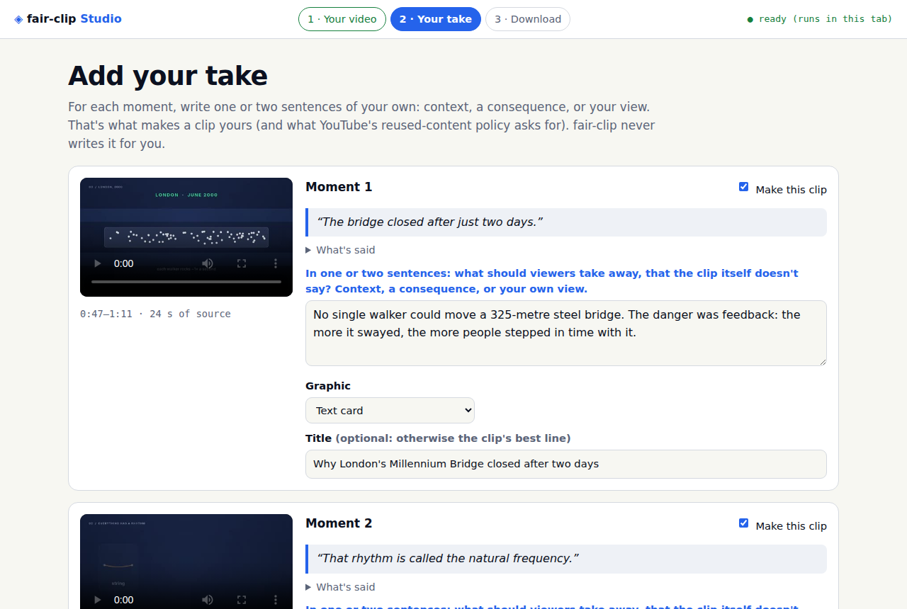
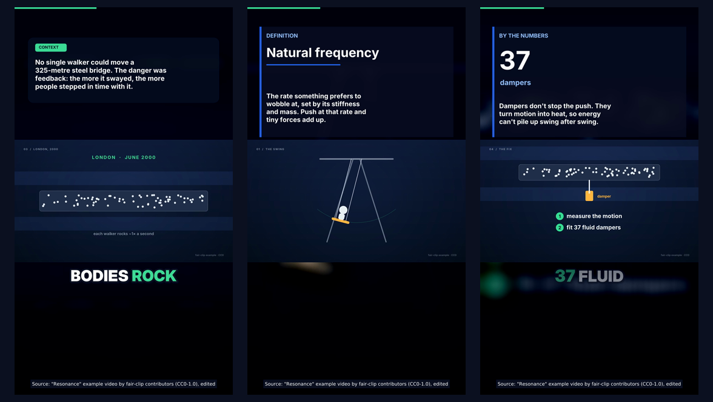

# Studio: finished clips in three steps

The Studio is the short way through fair-clip. You bring a video you have the rights to; it gives
you back finished clips plus the text you need to post them. Your judgment stays in: each clip
carries a sentence **you** wrote, and every clip goes through the full compliance gate before it
can be downloaded.

| Where | How | Your video |
|---|---|---|
| **Web** | [normansrule.github.io/fair-clip/studio/](https://normansrule.github.io/fair-clip/studio/) | stays in your browser tab |
| **App** | `fair-clip app` → **Open Studio** (or `http://127.0.0.1:8765/studio/`) | stays on your computer; FFmpeg runs in the media sandbox |
| **Command line** | `fair-clip studio VIDEO --captions FILE --project studio.json` | stays on your computer |



## 1 · Your video

- **Video:** MP4, MOV, WebM or MKV. In the browser, keep it under 4 GB and 3 hours.
- **Captions** (`.srt` or `.vtt`):
  - In the browser they're required, because that's how the page knows what was said and when. In YouTube Studio: **Subtitles → ⋮ → Download**. Auto-captions work, including per-word timings.
  - The app can transcribe instead if speech-to-text is installed (faster-whisper: `pip install '.[asr]'` in a source checkout).
- **Where is it from?** This becomes the rights record that binds the exact file (by SHA-256):
  - *I made it*: your own recording.
  - *Creative Commons / public domain*: pick the license and write the credit line. ND and ShareAlike licenses are refused. NC is refused for monetized channels.
  - *Written permission* or *I licensed it*: say where the proof is kept.
- **It has a realistic AI voice, AI people or altered footage:** tick it, and every clip's checklist tells you to tick YouTube's *altered or synthetic content* box.
- **Your look:**
  - **Channel name**, shown as a small pill.
  - **Style**: *Bold* is big pop captions; *Clean* and *Minimal* are quieter.
  - **Accent colour**: a yellow close to the disclosure cards is refused.
  - **Shape**: 9:16 or 16:9.
  - **Framing**: *whole frame* over a blurred fill suits slides and diagrams; *fill the screen* suits one speaker.
  - **How many clips**, 1 to 8.
  - **Topics**: comma separated, used to rank moments and for hashtags.

## 2 · Your take

fair-clip ranks the moments (speech energy, pace, topic words, few pauses; see
[EQUATIONS.md](EQUATIONS.md)). For each one you see:

- a still and the moment itself;
- the **hook**: the line the clip opens on, verbatim (fair-clip never invents a quote);
- **What's said**;
- a **question** to get you started. If the clip says a number, the *Key number* graphic is pre-filled with it.

Write your take: one or two sentences of context, a consequence, or your view. It's on screen for
about half the clip and leads the description. Optionally pick a graphic:

| Graphic | What you fill in |
|---|---|
| Text card | just your sentence |
| Key number | the number as said (e.g. `37`), a short label (`dampers`) |
| Definition | the term (`Natural frequency`) |
| Steps | 2–5 short steps, one per line |

**Title** is optional. Without one, the clip's hook line is used. A title may only use words and
numbers that are said in the clip or written in your take, and the page checks it as you type:

> *Title: not said in the clip or your take: aliens, secret. Titles may only use words from the clip or your take.*

Untick **Make this clip** to skip a moment.

## 3 · Download

Rendering takes from seconds to a few minutes per clip. In the browser it runs in the tab, so keep
the tab open. Each clip either:

- **passes**: you get the video and **Copy title / Copy description / Copy tags** buttons, plus its YouTube Studio checklist; or
- **is blocked**: you get the reasons and how to fix each one. Change your take or title, then make the clips again.

**Download all (.zip)** contains:

```text
01-why-londons-millennium-bridge-closed-after-two-d.mp4
01-why-londons-millennium-bridge-closed-after-two-d.txt   title, description, tags, checklist
...
ALL-TITLES-AND-DESCRIPTIONS.txt                           everything in one file
upload-sheet.csv                                          one row per clip (spreadsheets, bulk tools)
README.txt                                                how to post them; what was blocked and why
```

To post a clip: YouTube Studio → **Create → Upload videos** → paste the title and description →
work through the checklist (the *altered or synthetic* and *paid promotion* boxes can only be
ticked there) → upload as **Private**, watch it once on your phone, then publish.

To have fair-clip upload for you (private first, scheduled, with human approval and the audit
trail), use the [pipeline and dashboard](../README.md#how-it-works) instead.

## The example

[`examples/studio/`](../examples/studio) holds **Resonance**, a 2-minute explainer made for this project and dedicated to the public domain (CC0):

- animated diagrams drawn with pycairo;
- narration by the Kokoro-82M text-to-speech model (Apache-2.0);
- captions, a rights record, and `project.json` with the owner inputs used for the example clips: brand, rights, and a take and title per moment.

Press **Try it with the example video** in the Studio to load all of it.



Rebuild everything yourself:

```bash
pip install kokoro-onnx soundfile pycairo     # only to regenerate the video itself
python scripts/make_example.py                # examples/studio/source.mp4 + captions (≈ 10 min)
fair-clip studio examples/studio/source.mp4 --captions examples/studio/captions.srt \
  --project examples/studio/project.json --out out/example
python scripts/export_studio_example.py       # site cards, README image, release zip
```

## How the web Studio works

```text
your browser tab
 ├─ studio.js         the page (no innerHTML with data; strict CSP, no CDN)
 ├─ Pyodide           fair-clip's own Python: rights record, moments, overlays, FFmpeg args, metadata, the full gate
 └─ ffmpeg.wasm       reads your file in place (WORKERFS), renders with libass + x264, single-threaded
```

- **Engines:** `scripts/vendor_web.py` downloads Pyodide 0.28.3 and ffmpeg.wasm 0.12 (core 0.12.10) and checks them against pinned SHA-256 hashes. The site serves them from its own origin.
- **Size:** the first visit downloads about 50 MB, which your browser then caches.
- **Speed:** a 30-second vertical clip takes one to two minutes on a typical laptop. GitHub Pages can't send the headers multithreaded WebAssembly needs, so FFmpeg runs on one thread.
- **What's different from the app:** scene cuts aren't detected (decoding the whole video in the tab would be slow), and the duplicate check sees only this session, not your publishing history. Everything else is the same code.

Build it locally:

```bash
python scripts/vendor_web.py && python scripts/build_studio.py
python -m http.server -d site 8000      # then open http://127.0.0.1:8000/studio/
```

## Security notes

- **Browser:**
  - Nothing is uploaded.
  - The page's Content Security Policy allows only its own origin (plus `wasm-unsafe-eval` for WebAssembly and `blob:` for local previews).
  - Caption text and every string you type are treated as data: escaped into the subtitle file, never put into markup.
- **App:**
  - Same session and CSRF protection as the dashboard.
  - Uploads are size-checked before they're written, and each Studio session has its own folder, deleted as a whole.
  - Your file is decoded only in the media sandbox. Without Docker, only the bundled examples (pinned hashes) run on the host.
  - One render at a time. Analyze and make runs are written to the audit log.
- **The gate in the browser** runs on your own machine, so it protects you from mistakes. It isn't a lock against yourself. Uploading through fair-clip still goes through the app's approval flow.
